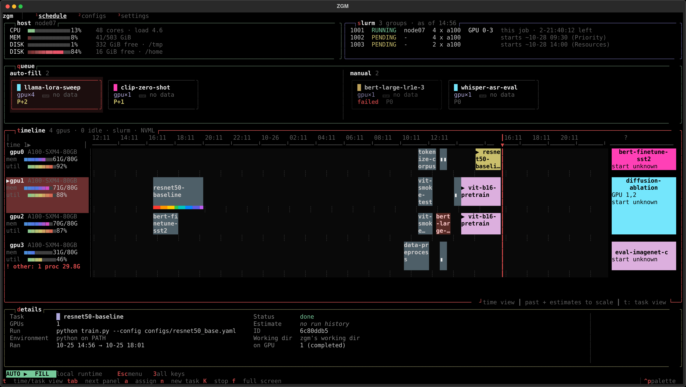
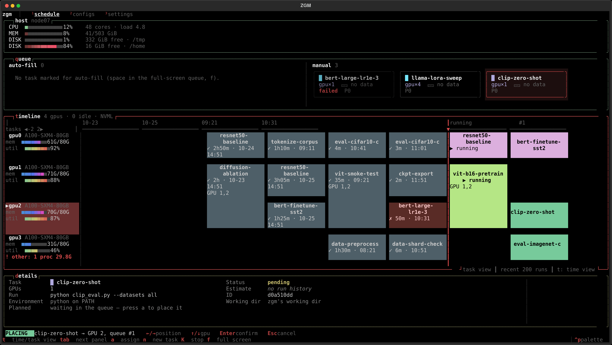
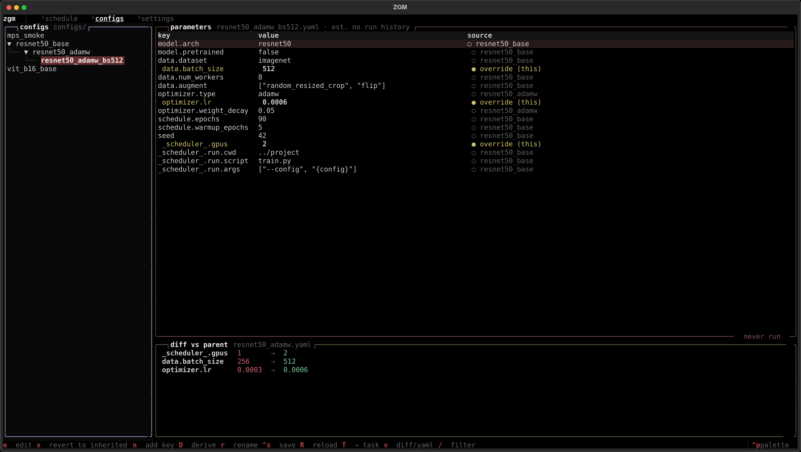

# ZGM

**A job queue for the GPUs in one machine, with a dashboard in your terminal.**

You have a few GPUs and a list of training runs. Put the runs in the queue, say which GPUs each one gets, and zgm starts each run as soon as its GPUs are free, one after another. You can watch it all on one screen: what's running, what's next, and what already finished.



<sub>Demo data. Left of the red line is what already ran; right of it, what is running and what comes next, in order.</sub>

> **Scripts and AI agents:** see [AGENTS.md](AGENTS.md) for using zgm from the command line only, with JSON output.

## What it does

- **Runs your queue for you.** When one job finishes, the next one waiting for those GPUs starts. Jobs on different GPUs run side by side.
- **Keeps away from busy GPUs.** If another program is already using a GPU, nothing new starts there until it is done. Running out of GPU memory halfway through a run is the usual way training fails on a shared machine.
- **Doesn't need to stay open.** Jobs run in the background. Close the dashboard, or log out of the terminal, and they keep going.
- **Fits how you already work.** Your training script doesn't change. zgm runs it in its folder, with your Python or conda environment, on the GPUs you picked. Your script sees those GPUs as `cuda:0`, `cuda:1`, ….
- **Learns how long things take.** After a job has run once, zgm estimates when the jobs behind it will start.
- **Keeps experiment settings tidy.** Settings files can build on each other, so a variant only lists what it changes.

## Install

You need Python 3.10 or newer. On a machine with NVIDIA GPUs, also install the NVIDIA driver and check that `nvidia-smi` works. An Apple Silicon Mac needs nothing extra: zgm reads its GPU through macOS (Metal), and jobs can use PyTorch's `mps` device.

```bash
git clone <repo-url> zgm
cd zgm
python3 -m venv .venv
.venv/bin/pip install -e .
```

On Windows, use `py -m venv .venv`, then `.venv\Scripts\pip install -e .`. In the commands below, `zgm` means `.venv/bin/zgm` (Windows: `.venv\Scripts\zgm.exe`). If you activate the environment, plain `zgm` works.

To look around first without touching anything, open the dashboard with made-up tasks (`q` quits):

```bash
zgm --demo --config-dir examples/configs --db demo.db
```

## Quick start

**1. Start zgm in the background.** It runs your queue from now on. You only do this once.

```bash
zgm daemon start
zgm daemon status        # the "gpus:" line should list your real GPUs
```

**2. Add a job.** Go to your project folder and tell zgm what to run and how many GPUs it needs:

```bash
cd ~/my-project
zgm submit --python ~/my-project/.venv/bin/python -g 2 -- train.py --lr 3e-4
```

zgm checks that the script and the Python exist, puts the job in line on the GPUs where it can start soonest, and says when that will be.

**3. Watch it.**

```bash
zgm                     # the dashboard
zgm list                # or a plain list in the terminal
zgm logs -f train       # follow a job's output (by name or id)
```

**4. Stop it** if you need to:

```bash
zgm stop train
```

## The dashboard

Run `zgm` to open it. It has two pages: **schedule** (key `1`) and **configs** (key `2`).

The schedule page has these parts, top to bottom:

- **host**: this machine's CPU, memory, and the disks of the state dir and the home directory (red when less than 10% is free: a full disk makes jobs and zgm fail). In cluster mode the groups of GPUs (e.g. your Slurm jobs or Macs) are listed beside it.
- **queue**: jobs that are waiting to be given GPUs. New jobs land here when you add them without GPUs, and so do stopped or failed jobs. Jobs marked for auto-fill are on the left, the others (manual) on the right, each side sorted by priority, highest first.
- **timeline**: one row per GPU, with its memory and load on the left. It has two views, switched with `v`:
  - **time**: the whole strip is to scale. History uses actual times; running and queued jobs use their estimates, so their blocks sit where they will run. Queued jobs with no estimate cannot be placed on the axis and wait in a `start unknown` tail on the right. The red line is now.
  - **tasks**: one fixed-width card per run, in order: the last 200 finished runs, then running and queued jobs. A run of a few seconds is as readable as one of several hours.
  A job using several GPUs spans several rows. Both views support placing and dragging jobs.
- **details**: everything about the selected job. On the right, its config as the configs page's tree shows it, cut down to the config and its parents.

To give a job GPUs, select it in the queue and press `a`. A preview shows where it would go. Move it with the arrow keys and press `Enter`, or drag the card with the mouse.



The bottom line shows the common keys; the settings page (`3`) lists them all.

| key | what it does |
|---|---|
| `q` `d` `t` `s` | go to the queue / details / timeline / cluster panel |
| `Tab` / `Shift+Tab` | go to the next / previous panel, top to bottom |
| `f` | show the focused panel full screen, or back |
| `a` | place the selected job on GPUs |
| `←` `→` / `↑` `↓` | while placing: move it earlier/later in line, or to other GPUs |
| `Enter` / `Esc` | confirm / cancel; on the timeline, `Enter` picks up a queued job to move it |
| `[` `]` | move the selected job one place earlier / later |
| `u` | take a job off the timeline, back to the queue |
| `n` / `e` / `x` | new job / edit / delete |
| `r` | start a job before its turn (as soon as its GPUs are free) |
| `K` | stop a running job |
| `p` | pause or resume starting jobs automatically |
| `1` `2` `3` | schedule / configs / settings view |
| `v` | switch the timeline between the time view and the task view |
| `h` `l` / `+` `-` | timeline: pan / zoom the time, or scroll the cards |
| `g` | on the timeline: back to now |
| `Esc` | cancel, or leave full screen; otherwise a menu with Options and Exit (running jobs keep running) |

The bar at the bottom says whether jobs are being started automatically (**AUTO**), are paused (**PAUSED**), or whether nothing is running the queue (**PLAN ONLY**; start it with `zgm daemon start`). **FILL** next to AUTO means auto-fill is on.

The settings view (`3`) holds switches that every zgm on the queue shares:

- **Auto-start** (the same as `p`).
- **Auto-fill idle GPUs**: when a GPU has nothing running or queued, zgm starts the oldest job of the queue's *auto-fill* section that fits there. Jobs whose last run failed or was stopped are left for you.

Full screen (`f`), the queue lists its jobs in two sections, **auto-fill** and **manual**, and in each by the folder of their config. New jobs go to manual. `space` moves the selected job to the other section, `A` its whole folder; `zgm submit --autofill` adds a job straight to auto-fill. Auto-fill takes the job with the highest priority first (`+` / `-` there, `zgm submit --priority N`, or `_scheduler_.priority` in a config; default 0), the oldest among equals.

## Running your own code

Each job is three things: **where** to run (a folder), **with which environment** (a Python, or a conda environment), and **what** to run. You give them when you add the job:

```bash
zgm submit --python /path/to/venv/bin/python -C /path/to/project -- train.py --epochs 90
zgm submit --conda torch -- -m mypackage.train --bs 64
zgm submit -g 4 --cmd "torchrun --nproc_per_node={num_gpus} train.py"
```

- Anything that isn't a `.py` file or `-m module` runs as a shell command, so `torchrun`, `bash run.sh` and so on work too.
- Without `--python` or `--conda`, zgm uses the environment you are in when you run `zgm submit`.
- Your job's output goes to a log file: `zgm logs NAME` shows it, `zgm logs -f NAME` follows it until the job ends.
- Your job sees only its own GPUs, through `CUDA_VISIBLE_DEVICES`. Use `cuda:0` and up, as usual.

The dashboard's `n` key asks for the same things in a form.

## Command line

| command | what it does |
|---|---|
| `zgm` | open the dashboard |
| `zgm submit [options] -- COMMAND` | add a job (`zgm submit -h` lists the options) |
| `zgm list` | all jobs: status, GPUs, exit code |
| `zgm logs NAME [-f]` | a job's output; `-f` follows it until it ends |
| `zgm stop NAME` | stop a running job, or take a waiting one out of line |
| `zgm daemon start` / `status` / `stop` | run the queue in the background / check on it / stop it (running jobs keep running) |
| `zgm check` | check the setup: the state directory, the GPUs, and (with `--cluster` / `--host`) every other host |

`zgm submit`, `zgm list` and `zgm stop` can print JSON with `--json`; see [AGENTS.md](AGENTS.md).

## Experiment settings (configs)

The configs page manages YAML settings files that build on each other. A file names the file it builds on in `_base_` and lists only what it changes:

```yaml
# resnet50_adamw_bs512.yaml
_base_: resnet50_adamw.yaml   # start from this file...
data:
  batch_size: 512             # ...and change these
optimizer:
  lr: 6.0e-4
```



For every setting, the page shows the file it comes from: `○` inherited, `●` changed in this file. Press `e` to edit a value (only this file changes, never its parent), `D` to make a variant, and `T` to turn the file into a job. A settings file can also say how its job runs, in a `_scheduler_` section:

```yaml
_scheduler_:
  gpus: 2
  run:
    cwd: ../my-project
    conda: torch
    script: train.py
    args: [--config, "{config}"]   # zgm passes the merged settings as one plain file
```

`examples/configs` has a small family of these files, and `examples/project/train.py` a stand-in training script, so you can try the whole thing end to end:

```bash
zgm --config-dir examples/configs --db demo.db --runtime local   # T on a config, a to place it
```

## Good to know

- **GPUs used by other programs.** On NVIDIA, zgm asks the driver which programs are computing on each GPU. If one isn't a zgm job, the GPU is marked in red on the timeline (`! other`) and nothing new starts there. Programs that only draw on screen (your desktop, a browser) don't count. macOS doesn't expose per-process GPU use without root, so on a Mac zgm can only keep its own jobs from sharing a GPU; another program's use is not detected.
- **Closing things.** Closing the dashboard or running `zgm daemon stop` doesn't stop your jobs. The next time zgm runs the queue, it picks them up and records how they ended.
- **Apple Silicon Macs.** zgm uses the Mac's GPU as one device (unified memory), and jobs reach it through PyTorch's `mps` backend. On a Mac without an Apple GPU, or on any machine without a usable GPU, zgm shows 4 pretend GPUs so you can try it out, and `zgm daemon status` says so.
- **Several machines?** One queue can span several hosts. On a Slurm cluster, `zgm daemon start --cluster slurm` uses the GPUs of all your running jobs and adds a job's GPUs as soon as it starts. Several Macs work the same way: `export ZGM_MACS=mac-a,mac-b` (or one host per line in `$ZGM_HOME/macs`), then `zgm daemon start --cluster macs`; this puts one GPU from each Mac in the queue (each task still runs on one Mac). Every host must mount the state dir at the same path and accept a passwordless ssh login. Run `zgm check --cluster slurm` or `zgm check --cluster macs` first. See [how it works](docs/how-it-works.md#several-hosts-cluster-mode).
- **One queue per database.** The queue is kept in `~/.local/share/zgm/state.db` (or `$ZGM_HOME/state.db`). Pass `--db` to every command to use another one. On storage other users share, use a directory of your own, e.g. `ZGM_HOME=/shared/$USER/zgm`.
- **Looks.** The dashboard uses your terminal's font and size. A modern terminal (Windows Terminal, iTerm2, kitty, ...) with a monospace font such as Cascadia Mono or JetBrains Mono, at least 100×30 characters, looks best.

## More

- [docs/how-it-works.md](docs/how-it-works.md): the details: how the queue decides, how jobs run in the background, how busy GPUs are detected, and the code layout.
- [AGENTS.md](AGENTS.md): using zgm from scripts and AI agents, and working on its code.

## Development

```bash
.venv/bin/pip install -e ".[dev]"        # add ",ray" to also test the Ray runtime
.venv/bin/python -m pytest -q            # about a minute
.venv/bin/python scripts/make_screenshots.py   # redo the pictures above after changing the UI
```
